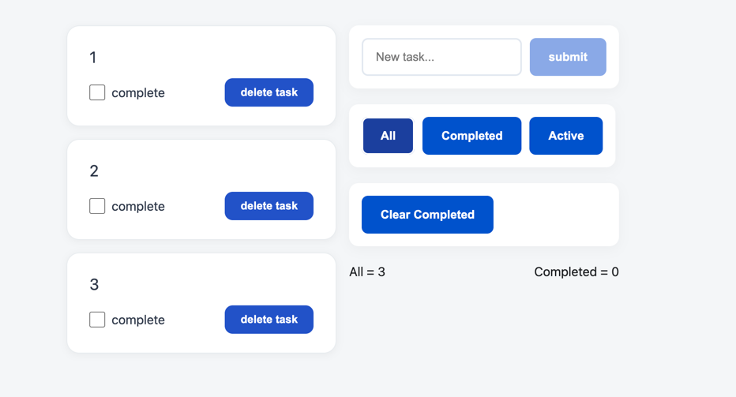

# Todo List

A simple todo app I built with React and TypeScript to finally understand how state, props and components fit together. I'm coming from WordPress, so the "data flows down, events go up" idea took me a while to click. This project is where it did.

**Live demo:** https://pet-react1.vercel.app



## What it does

- Add tasks (empty or whitespace-only input is ignored)
- Mark tasks as done, or delete them
- Click a task's text to edit it: Enter saves, Escape cancels
- Filter the list by status
- See how many tasks you have and how many are completed
- Clear all completed tasks at once
- Tasks are saved in `localStorage`, so they survive a page refresh

## Built with

React 19, TypeScript, Vite, React Router 7, Less, oxlint. Deployed on Vercel.

## Run it locally

You'll need Node.js 20+.

```bash
git clone https://github.com/ArtemLerner/pet-react_1.git
cd pet-react_1
npm install
npm run dev
```

Then open http://localhost:5173.

Other scripts:

- `npm run build` - type-check and build for production
- `npm run preview` - preview the production build
- `npm run lint` - run oxlint
- `npm test` - run the unit tests (Vitest)

## How it's organized

```
src/
├── app/router.tsx       # routes
├── components/          # Form, Task, FilterButton
├── hooks/tasks.tsx      # useTask: state and actions
├── pages/HomePage.tsx   # the main page
├── shared/types/        # Task type and filter values
├── utils/tasks.ts       # pure functions (toggle, filter), covered by tests
├── index.less           # global styles
└── main.tsx             # entry point
```

The task list lives in the `useTask` hook, and `HomePage` hands the actions down as props. Components like `Form` and `Task` don't change any data themselves. They just call the function they were given, like `addTask` or `onDelete`.

I moved the logic that doesn't need React (toggling a task, filtering) into plain functions in `utils/`. That way it's easy to test without rendering anything.

## Things I learned along the way

- State shouldn't be mutated directly. Create a new array or object and pass it to `setTasks`, otherwise React won't re-render.
- Values you can calculate from existing state (the filtered list, the counters) don't need their own `useState`.
- The filter only changes what's shown, not what's stored, so switching back to "All" brings everything back.
- Some of my bugs came from a Cyrillic letter hiding in a file name and a variable name. They look identical to the Latin ones, and that cost me an evening.

## What I want to add next

- Tests for the components with React Testing Library
- A responsive layout for phones
- A small Node.js backend, so tasks live on a server instead of in the browser

## Deployment

Every push to `main` goes live on Vercel. Because it's a single-page app, `vercel.json` sends all routes to `index.html`:

```json
{
  "rewrites": [{ "source": "/(.*)", "destination": "/index.html" }]
}
```

## Contact

Artem Lerner - [GitHub](https://github.com/ArtemLerner)